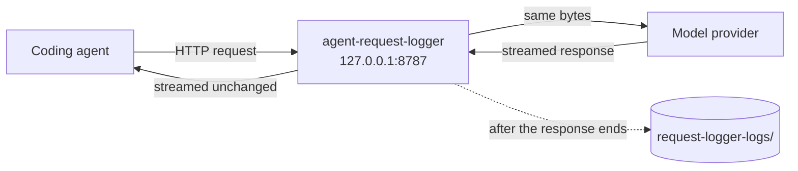

<p align="center">
  
</p>

<h1 align="center">agent-request-logger</h1>

<p align="center">
  See exactly what your coding agent sends to its model provider.
</p>

<p align="center">
  <a href="https://www.npmjs.com/package/agent-request-logger"></a>
  <a href="https://github.com/chepetime/agent-request-logger/actions/workflows/ci.yml"></a>
  <a href="https://github.com/chepetime/agent-request-logger/actions/workflows/compatibility.yml"></a>
  
  <a href="https://github.com/chepetime/agent-request-logger/blob/main/LICENSE"></a>
</p>

`agent-request-logger` is a local HTTP proxy for coding agents. It forwards
each request to the real provider, streams the response back unchanged, and
saves a readable Markdown capture of the system prompt, tools, messages,
response text, reasoning, tool calls, and token usage.

Works with **Claude Code, Codex, GitHub Copilot CLI, OpenCode, and Pi**, plus
any OpenAI- or Anthropic-compatible endpoint.

```sh
npx agent-request-logger
```

## Why

Coding agents build large prompts that you never see: system instructions,
tool schemas, injected context, and retries. When an agent behaves strangely,
the fastest way to understand it is to read the exact request it sent. This
tool shows you that request with one command, without changing the agent,
signing in again, or sending data anywhere except the provider you already use.

## Quick start

Requires **Node.js 22.15 or newer** and an installed, signed-in coding agent.

1. In the project where you want captures, start the logger:

   ```sh
   npx agent-request-logger
   ```

2. Choose your agent and provider. The logger can remember the choice.
3. In a second terminal, run the command that the logger prints, for example:

   ```sh
   ANTHROPIC_BASE_URL='http://127.0.0.1:8787' ENABLE_TOOL_SEARCH=true claude
   ```

4. Send a message to the agent. Open the newest `.md` file in
   `./request-logger-logs/`.
5. Press <kbd>Ctrl</kbd>+<kbd>C</kbd> in the logger terminal. Open streams are
   saved before it exits.

Generated commands use bash or zsh syntax. Some setups also print a JSON
snippet to merge into the agent's configuration file. See
[agent setup](https://github.com/chepetime/agent-request-logger/blob/main/docs/agents.md)
for every agent and provider.

## How it works



- Requests and responses pass through byte for byte, including credentials
  and compression. Streaming tokens reach the agent without delay.
- The capture is written only after the response finishes, so formatting
  never slows the agent down.
- The logger listens on loopback only. Nothing leaves your machine except the
  traffic that already goes to your provider.

## Captures

One agent turn can send several model requests. Each request produces three
files that share a timestamp and request ID:

| File            | Contents                                                                |
| --------------- | ----------------------------------------------------------------------- |
| `.md`           | Headers, system instructions, tools, messages, response text, and usage |
| `.request.txt`  | The original request body bytes, including compression                  |
| `.response.txt` | The original response body bytes                                        |

The `.md` file is written last, so its presence means the raw files are
complete. Token-counting and health-check requests pass through without a
capture.

## Options

| Option                | Environment variable        | Default                    |
| --------------------- | --------------------------- | -------------------------- |
| `--port <number>`     | `PORT`                      | `8787`                     |
| `--log-dir <path>`    | `REQUEST_LOGGER_LOG_DIR`    | `./request-logger-logs`    |
| `--config-dir <path>` | `REQUEST_LOGGER_CONFIG_DIR` | `~/.agent-request-logger`  |
| `--force`             |                             | Choose the setup again     |
| `--debug`             | `REQUEST_LOGGER_DEBUG=1`    | Add stack traces to errors |
| `-h`, `--help`        |                             | Show help                  |
| `-v`, `--version`     |                             | Show the installed version |

Flags take precedence over environment variables. Relative paths resolve from
the directory where you start the logger, also with `npx`, a global install,
or an npm script. Unknown flags are rejected, so a typo never runs a
different setup.

`--force` asks again but keeps the saved setup until you save a new one.
Cancelling the wizard does not lose your previous choice.

## Install options

```sh
npx agent-request-logger           # run without installing
npm i -g agent-request-logger      # install the command globally
npm i -D agent-request-logger      # add it to a project
```

In a project, add a script and pass options after `--`:

```json
{ "scripts": { "log:agent": "agent-request-logger" } }
```

```sh
npm run log:agent -- --port 9000
```

## Privacy and safety

- Credential headers such as `authorization`, `x-api-key`, `cookie`, and any
  header named like a token, secret, or key are shown as `[REDACTED]` in
  Markdown captures.
- Request and response **bodies are not redacted**. They can contain your
  code, file contents, and secrets. Add the capture directory to `.gitignore`.
- Capture files are created with owner-only permissions (`0600`, in a `0700`
  directory).
- Each body copy is limited to 64 MiB. Larger traffic is still forwarded in
  full; the capture keeps the beginning and says that it is truncated.

This is a local inspection tool, not a production telemetry proxy. See
[SECURITY.md](https://github.com/chepetime/agent-request-logger/blob/main/SECURITY.md)
to report a vulnerability.

## Documentation

- [Agent setup and troubleshooting](https://github.com/chepetime/agent-request-logger/blob/main/docs/agents.md)
- [Architecture](https://github.com/chepetime/agent-request-logger/blob/main/docs/architecture.md)
- [Testing](https://github.com/chepetime/agent-request-logger/blob/main/docs/testing.md)
- [Releases](https://github.com/chepetime/agent-request-logger/blob/main/docs/releases.md)
- [Contributing](https://github.com/chepetime/agent-request-logger/blob/main/CONTRIBUTING.md)
- [Changelog](https://github.com/chepetime/agent-request-logger/blob/main/CHANGELOG.md)

## License

[MIT](https://github.com/chepetime/agent-request-logger/blob/main/LICENSE).
Free to use, change, and share.
