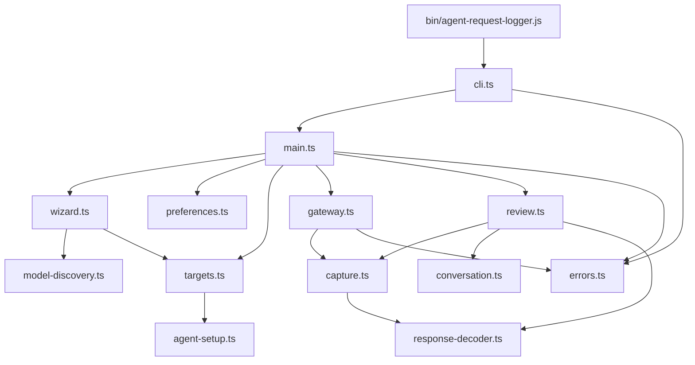

# Architecture

`agent-request-logger` is a small CLI with one job: sit between a coding agent
and its model provider, forward traffic unchanged, and write readable captures.
This page explains how the parts fit together and which rules they must keep.

## Modules

| Module                        | Responsibility                                                                  |
| ----------------------------- | ------------------------------------------------------------------------------- |
| `bin/agent-request-logger.js` | Four-line launcher. Imports the compiled CLI and sets the exit code.            |
| `src/cli.ts`                  | The only reader of argv and environment. Produces typed `StartOptions`.         |
| `src/main.ts`                 | Setup selection, server start, printed instructions, and graceful shutdown.     |
| `src/wizard.ts`               | Interactive questions and cancellation.                                         |
| `src/preferences.ts`          | Launch-relative paths and the remembered choice (atomic writes).                |
| `src/targets.ts`              | Agent and provider catalogue, URL validation, and route resolution.             |
| `src/agent-setup.ts`          | Launch commands and configuration snippets for each agent.                      |
| `src/model-discovery.ts`      | Optional `/v1/models` listing for custom providers.                             |
| `src/gateway.ts`              | HTTP forwarding, stream lifecycle, bounded body copies, capture scheduling.     |
| `src/review.ts`               | The session review index: per-request summaries, prompt deduplication, framing. |
| `src/conversation.ts`         | Message history: stable hashes, compact message lines, and turn matching.       |
| `src/capture.ts`              | Markdown rendering, header redaction, and raw file persistence.                 |
| `src/response-decoder.ts`     | Anthropic and OpenAI response interpretation (SSE and JSON).                    |
| `src/errors.ts`               | Error codes, cause chains, and diagnostic formatting.                           |

## Request lifecycle

1. `cli.ts` parses flags and environment variables into `StartOptions`.
   Unknown flags fail. Nothing else in the program reads `process.argv` or
   configuration environment variables.
2. `main.ts` loads the saved choice or runs the wizard, then resolves a
   `Target`: upstream URL, wire protocol, launch command, and config files.
3. `createGateway` returns a `Gateway` with `server`, `flush()`, and
   `close()`. The server listens on `127.0.0.1` only.
4. For each request, the gateway removes hop-by-hop headers, asks for an
   uncompressed response (`accept-encoding: identity`), and pipes the body to
   the upstream. It never changes the request body or its encoding.
5. The upstream response is piped to the agent immediately. In parallel, a
   bounded copy of each body is kept for the capture.
6. When the response ends, or the client disconnects, the exchange is
   recorded once. Model requests (`/messages`, `/responses`,
   `/chat/completions`) are written to disk; other traffic is forwarded only.
7. After each capture write, `onCapture(file, exchange)` lets `main.ts` add a
   summary row to the session's `ReviewSession`, which rewrites the review
   file atomically. Writes are queued, so rows are never lost to a race.
8. On SIGINT or SIGTERM, `close()` stops new connections, ends open streams
   (which records their partial responses), and waits for every capture
   write and the last review update. A second signal exits at once.

## Invariants

These rules are covered by tests. Keep them when you change the code.

- **Traffic is never changed or cut.** Capture limits, decoding failures, and
  disk errors affect only the capture, never the bytes the agent receives.
- **Streaming is never delayed.** Captures are formatted after the response
  ends.
- **Captures are consistent.** Raw files are written first and the `.md` file
  last. Files use mode `0600` in a `0700` directory.
- **Credentials are never rendered.** Header names that look like
  credentials are redacted in Markdown. Bodies are kept as sent.
- **Memory is bounded.** Each body copy stops at `maxCaptureBytes`
  (64 MiB by default) and the capture says that it is truncated.
- **Saved setups are never lost by accident.** `--force` does not delete the
  saved file, and preference writes use write-then-rename.
- **The configured host cannot be changed by a request.** Incoming paths are
  joined to the base path; `//other.host` stays a path.
- **The review file stays small and safe to read.** It never contains a full
  prompt. It frames captures as data, so a reviewing agent does not follow
  instructions found in them.
- **New messages are found by content, not position.** A request continues
  the latest earlier request whose message hashes are a prefix of its own.
  Prompt-caching markers are ignored in hashes because they move every turn.
- **Retries cannot flood the disk.** Identical model captures are limited to
  20 in a two-second window. Every response is still forwarded.

## Design decisions

- **One runtime dependency.** Only `@clack/prompts` for the wizard. Forwarding,
  decoding, and file output use Node built-ins.
- **Explicit options instead of globals.** Earlier versions passed flags
  through `process.env` and re-read `process.argv` in several modules. All
  configuration now flows through `StartOptions`, so each module can be tested
  without spawning a process.
- **IPv4 loopback in generated commands.** The server binds `127.0.0.1`, so
  printed URLs use `127.0.0.1` instead of `localhost`, which can resolve to
  `::1` first on some systems.
- **Display protocol is not translation.** The custom "capture format" only
  controls how the Markdown is rendered. The endpoint must accept what the
  agent sends.
- **HTTP only.** WebSocket upgrades get an immediate `426` so agents with an
  HTTP fallback use it.

## Extending

To add an agent or provider, see
[CONTRIBUTING.md](../CONTRIBUTING.md#add-an-agent-or-provider). Routing data
belongs in `targets.ts`, launch instructions in `agent-setup.ts`, and response
shapes in `response-decoder.ts`.
